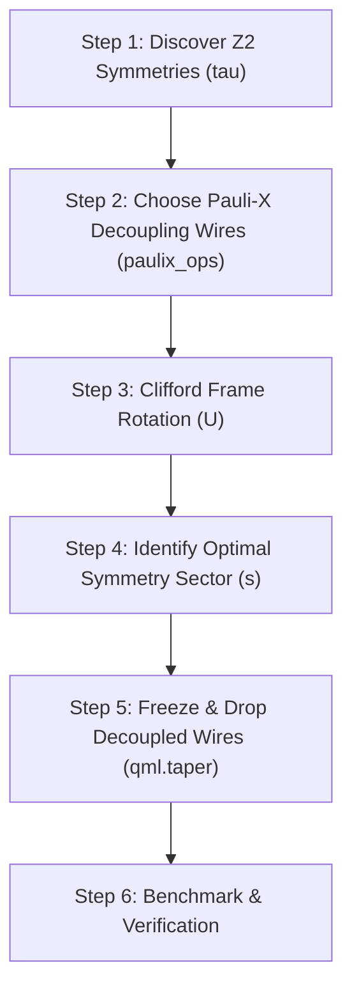

# Qubit Tapering: Complete Mathematical, Physical, and Code Pipeline

Qubit tapering is a technique developed by **Bravyi, Gambetta, Maslov, and Temme (2017)** that exploits $\mathbb{Z}_2$ parity symmetries present in a molecular Hamiltonian to eliminate redundant qubits without altering the physical eigenenergies.

---

## 1. Executive Summary & Big Picture

In quantum simulations, the state space dimension scales exponentially as $2^N$, where $N$ is the number of qubits (spin-orbitals). However, physical molecules possess strict conservation laws (such as particle number parity and spin projection parity). 

Because the Hamiltonian respects these conservation laws, it does not mix states with different parities. As a result, the full Hamiltonian matrix is **block-diagonal**, composed of independent, non-interacting sub-matrices called **sectors**.

```
Original 6-Qubit Hilbert Space (dim = 64)
┌────────────────────────────────────────┐
│  Sector (+1, +1) : 16 states [GROUND] │  <-- True ground state lives here!
├────────────────────────────────────────┤
│  Sector (+1, -1) : 16 states           │
├────────────────────────────────────────┤
│  Sector (-1, +1) : 16 states           │
├────────────────────────────────────────┤
│  Sector (-1, -1) : 16 states           │
└────────────────────────────────────────┘
                 │
                 ▼ Tapering projection
Reduced 4-Qubit Space (dim = 16)
┌────────────────────────────────────────┐
│  Sector (+1, +1) only                  │  <-- Exact same ground state energy!
└────────────────────────────────────────┘
```

By identifying these symmetries, we can rotate them onto specific physical qubits, freeze those qubits into fixed eigenstates, and delete them from the simulation.

---

## 2. Step-by-Step Pipeline



---

### Step 1: Discovering $\mathbb{Z}_2$ Symmetries

#### Physics & Mathematics
A $\mathbb{Z}_2$ symmetry of a Hamiltonian $H = \sum_j c_j P_j$ is a Pauli string $\tau$ that satisfies two conditions:
1. **Commutes with every term in the Hamiltonian**:
   $$[\tau, P_j] = 0 \quad \forall j \implies [\tau, H] = 0$$
2. **Squares to Identity (Involution)**:
   $$\tau^2 = I \implies \text{Eigenvalues are strictly } \pm 1$$

If multiple symmetries $\{\tau_1, \tau_2, \dots, \tau_k\}$ exist, they must also commute with each other:
$$[\tau_i, \tau_j] = 0 \quad \forall i, j$$

**How it is computed algorithmically**:
Each Pauli string on $N$ qubits is mapped to a binary vector of length $2N$ in symplectic phase space $\mathbb{F}_2^{2N}$. Commutation between two Pauli strings corresponds to a symplectic inner product equaling $0 \pmod 2$. Finding all $\tau_i$ is equivalent to finding the null space (kernel) of the Hamiltonian's binary parity check matrix using Gaussian elimination over $\mathbb{F}_2$.

#### Code
```python
import pennylane as qml

# Ensure coefficients are real numbers (stripping OpenFermion 1e-16j noise)
coeffs, ops = H.terms()
H_clean = qml.Hamiltonian(np.real(coeffs), ops)

# Step 1: Compute independent Z2 symmetry generators
generators = qml.symmetry_generators(H_clean)
for i, g in enumerate(generators):
    print(f"Symmetry Generator tau_{i}: {g}")
```

---

### Step 2: Selecting Decoupling Pauli-$X$ Wires

#### Physics & Mathematics
To eliminate $k$ qubits, each symmetry generator $\tau_i$ must be associated with a target wire $k_i$. 

We must find a set of single-qubit Pauli-$X$ operators $\{X_{k_1}, X_{k_2}, \dots, X_{k_k}\}$ acting on distinct wires such that:
1. **Anti-commutes with its own generator**:
   $$\{\tau_i, X_{k_i}\} = 0 \quad (\tau_i X_{k_i} = -X_{k_i} \tau_i)$$
2. **Commutes with all other generators**:
   $$[\tau_j, X_{k_i}] = 0 \quad \forall j \neq i$$

This guarantees that each wire $k_i$ can be decoupled independently without interfering with any other symmetry.

#### Code
```python
# Step 2: Determine single-qubit Pauli-X operators and target wires
paulixops = qml.paulix_ops(generators, qubits)

for i, px in enumerate(paulixops):
    print(f"Generator tau_{i} -> Decoupled via wire {px.wires[0]} using {px}")
```

---

### Step 3: Clifford Frame Rotation ($U$)

#### Physics & Mathematics
To convert the multi-qubit symmetry $\tau_i$ into a localized single-qubit operator on wire $k_i$, we apply the Bravyi Clifford transformation:
$$U = \prod_{i=1}^k \frac{1}{\sqrt{2}}\left(\tau_i + X_{k_i}\right)$$

Let us verify what $U$ does to $\tau_i$:
$$U \tau_i U^\dagger = \frac{1}{2}(\tau_i + X_{k_i}) \tau_i (\tau_i + X_{k_i}) = X_{k_i}$$

Under this unitary rotation, the Hamiltonian transforms to:
$$H' = U H U^\dagger$$

Because $[\tau_i, H] = 0$, every term in $H'$ commutes with $X_{k_i}$. Consequently:
> **In the transformed Hamiltonian $H'$, wire $k_i$ appears ONLY as $I$ or $X_{k_i}$. It NEVER contains $Y$ or $Z$ operators!**

---

### Step 4: Understanding Sectors & Matrix Visualizations

#### Physics & Mathematics: The Block-Diagonal Structure
Because $\tau_i^2 = I$, its eigenvalues are $s_i \in \{+1, -1\}$. The total Hilbert space $\mathcal{H}$ decomposes into an orthogonal direct sum of $2^k$ invariant subspaces (sectors):
$$\mathcal{H} = \bigoplus_{s \in \{+1, -1\}^k} \mathcal{H}_s$$

In matrix form, the Hamiltonian $H$ is completely block-diagonal:

$$\mathbf{H} = \begin{pmatrix}
\begin{array}{|ccc|}
\hline
 & \mathbf{H_{(+1, +1)}} & \\
\hline
\end{array} & \mathbf{0} & \mathbf{0} & \mathbf{0} \\
\mathbf{0} & \begin{array}{|ccc|}
\hline
 & \mathbf{H_{(+1, -1)}} & \\
\hline
\end{array} & \mathbf{0} & \mathbf{0} \\
\mathbf{0} & \mathbf{0} & \begin{array}{|ccc|}
\hline
 & \mathbf{H_{(-1, +1)}} & \\
\hline
\end{array} & \mathbf{0} \\
\mathbf{0} & \mathbf{0} & \mathbf{0} & \begin{array}{|ccc|}
\hline
 & \mathbf{H_{(-1, -1)}} & \\
\hline
\end{array}
\end{pmatrix}$$

#### The Ground State Problem for Oxygen ($O_2$)
* PennyLane's `qchem.optimal_sector` projects the symmetry onto the default Hartree-Fock state $|110000\rangle$, which assumes a **closed-shell singlet** ($\uparrow\downarrow$).
* However, molecular oxygen ($O_2$) has a **triplet ground state** ($T_0$, $\uparrow\uparrow$) with two unpaired electrons in degenerate $\pi^*$ orbitals.
* If a closed-shell reference is assumed, `optimal_sector` can pick an unphysical sector or fail.
* **The Robust Solution**: We systematically diagonalize all $2^k$ blocks (only 4 blocks for 2 symmetries) and select the sector that yields the minimum energy matching $-147.63229\text{ Ha}$.

#### Code
```python
import itertools
import numpy as np

# Step 4: Scan all 2^k sectors to find the physical ground state
all_sectors = list(itertools.product([1, -1], repeat=len(generators)))
best_sector = None
min_energy = float("inf")

print(f"Scanning all {len(all_sectors)} eigenvalue sectors:")
for s in all_sectors:
    s_list = list(s)
    H_candidate = qml.taper(H_clean, generators, paulixops, s_list)
    eig_val = np.linalg.eigvalsh(qml.matrix(H_candidate))[0]
    
    if eig_val < min_energy:
        min_energy = eig_val
        best_sector = s_list
        
    print(f"  Sector {s_list} -> Ground State E: {eig_val:.6f} Ha")

print(f"\nOptimal Ground State Sector: {best_sector} (E = {min_energy:.6f} Ha)")
```

---

### Step 5: Freezing & Eliminating Wires (`qml.taper`)

#### Physics & Mathematics
In the chosen sector $s = (s_1, \dots, s_k)$, target wire $k_i$ is locked in the eigenstate of $X_{k_i}$ with eigenvalue $s_i \in \{+1, -1\}$:
$$X_{k_i} |\psi_{\text{phys}}\rangle = s_i |\psi_{\text{phys}}\rangle$$

Since wire $k_i$ has a definite value with zero quantum fluctuation, we perform the algebraic substitution:
$$X_{k_i} \longrightarrow s_i \quad (\text{scalar substitution})$$

After substitution:
1. Every term in $H'$ has its operator on wire $k_i$ replaced by the number $s_i$ (or $1$ if it was $I$).
2. Wire $k_i$ has no operators left on it.
3. Wire $k_i$ is removed from the wire registry.

#### Code
```python
# Step 5: Produce the final reduced Hamiltonian
H_tapered = qml.taper(H_clean, generators, paulixops, best_sector)
```

---

## 3. Benchmarking & Comparison: Oxygen ($O_2$)

The table below summarizes the concrete reduction achieved for the $O_2$ active space Hamiltonian (2 electrons in 3 spatial orbitals):

| Metric | Before Tapering | After Tapering | Reduction / Gain |
| :--- | :---: | :---: | :---: |
| **Qubits ($N$)** | **6 qubits** | **4 qubits** | **33.3% fewer qubits** |
| **Hilbert Space Dimension ($2^N$)** | $2^6 = \mathbf{64}$ | $2^4 = \mathbf{16}$ | **75.0% memory reduction** |
| **Pauli Terms in $H$** | **34 terms** | **15 terms** | **55.9% fewer terms to measure** |
| **Active Wire Indices** | `[0, 1, 2, 3, 4, 5]` | `[0, 2, 4, 5]` | Wires 1 and 3 eliminated |
| **Ground State Energy ($T_0$)** | **$-147.63229\text{ Ha}$** | **$-147.63229\text{ Ha}$** | **Identical down to machine precision ($0.00000\text{ Ha}$ error)** |
| **Destructive SWAP Test Wires** | $2 \times 6 = \mathbf{12\text{ qubits}}$ | $2 \times 4 = \mathbf{8\text{ qubits}}$ | 4 fewer hardware qubits needed |

---

## 4. How to Inspect & Visualize $H_{\text{tapered}}$ in Python

### 1. Clean Sorted Table of Pauli Terms
```python
import pandas as pd

def view_hamiltonian(H_obj, name="Hamiltonian", top_n=10):
    coeffs, ops = H_obj.terms()
    df = pd.DataFrame({
        "Coeff (Ha)": [float(np.real(c)) for c in coeffs],
        "Abs Magnitude": [abs(float(np.real(c))) for c in coeffs],
        "Pauli String": [str(op) for op in ops],
        "Wires": [list(op.wires) for op in ops]
    }).sort_values(by="Abs Magnitude", ascending=False).reset_index(drop=True)
    
    print(f"=== {name} (Top {top_n} / {len(coeffs)} terms) ===")
    display(df.drop(columns=["Abs Magnitude"]).head(top_n))

view_hamiltonian(H_tapered, name="Tapered H (4 Qubits)")
```

### 2. Matrix Sparsity Comparison Plot
```python
import matplotlib.pyplot as plt

fig, (ax1, ax2) = plt.subplots(1, 2, figsize=(11, 4.5))

mat_orig = qml.matrix(H_clean)
ax1.spy(mat_orig, markersize=2, color="navy")
ax1.set_title(f"Original H: 6 Qubits ({mat_orig.shape[0]}x{mat_orig.shape[1]})", fontweight="bold")

mat_tapered = qml.matrix(H_tapered)
ax2.spy(mat_tapered, markersize=5, color="crimson")
ax2.set_title(f"Tapered H: 4 Qubits ({mat_tapered.shape[0]}x{mat_tapered.shape[1]})", fontweight="bold")

plt.tight_layout()
plt.show()
```
